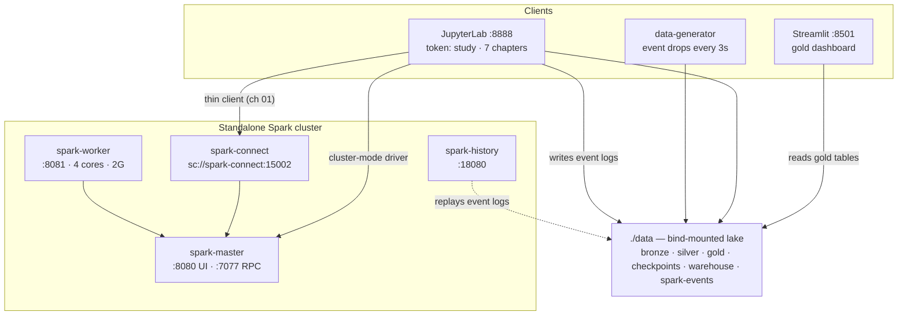
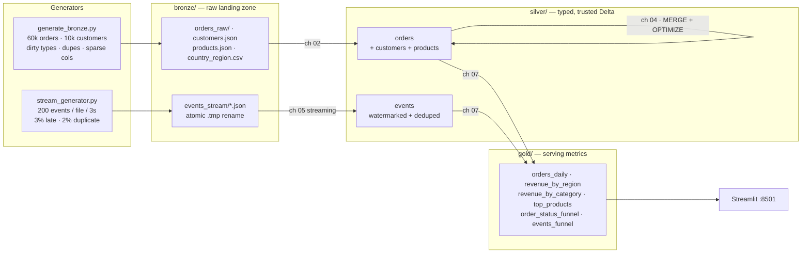
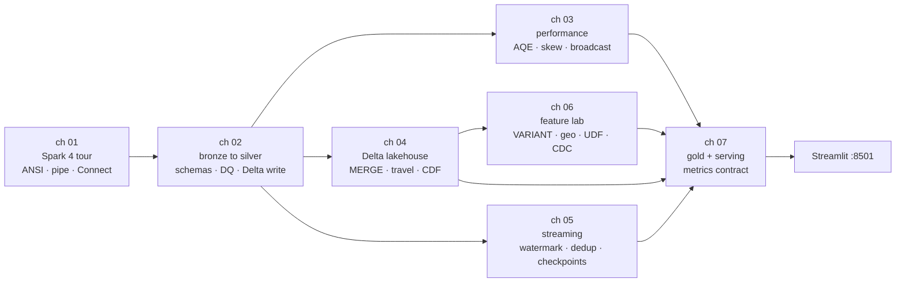
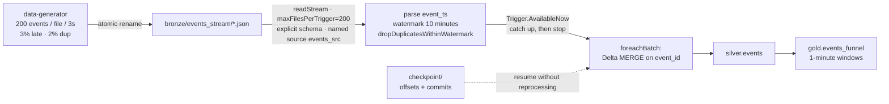

# de-labs — Data Engineering Study Stack

**Apache Spark 4.2 · Delta Lake 4.4 · Java 21 · Python 3.10** — a self-contained Docker
lakehouse you run locally, with a **7-chapter notebook course** of worked examples.

You already know Spark (≈3.5 era). This stack exists to close the gap to **Spark 4.2**
(released 2026-07-14): ANSI-by-default, VARIANT, pipe syntax, `QUALIFY`, native geospatial
types, SQL change-data-capture, Arrow-optimized Python UDFs, and Spark Connect — all
practiced on deliberately messy, realistic data.

**Contents**

1. [Stack at a glance](#1-stack-at-a-glance)
2. [Architecture](#2-architecture)
3. [Quickstart](#3-quickstart)
4. [The lakehouse data flow](#4-the-lakehouse-data-flow)
5. [Study path](#5-study-path)
6. [The chapters](#6-the-chapters)
   - [Ch 01 — Spark 4.x tour](#ch-01--spark-4x-tour)
   - [Ch 02 — Bronze → silver ETL](#ch-02--bronze--silver-batch-etl)
   - [Ch 03 — Performance & AQE](#ch-03--performance-aqe-and-plan-reading)
   - [Ch 04 — Delta Lake](#ch-04--delta-lake)
   - [Ch 05 — Structured Streaming](#ch-05--structured-streaming)
   - [Ch 06 — Spark 4.x feature lab](#ch-06--spark-4x-feature-lab)
   - [Ch 07 — Gold layer & serving](#ch-07--gold-layer--serving)
7. [Spark 3.5 → 4.2 cheat sheet](#7-spark-35--42-cheat-sheet)
8. [Configuration](#8-configuration)
9. [Make targets](#9-make-targets)
10. [Troubleshooting](#10-troubleshooting)
11. [Repository layout](#11-repository-layout)
12. [Further reading](#12-further-reading)

---

## 1. Stack at a glance

| Component | Version / choice | Why |
|---|---|---|
| Apache Spark | **4.2.0** (2026-07-14) | third 4.x release; everything in the cheat sheet below |
| Delta Lake | **4.4.1** (`delta-spark` + jars pre-fetched at image build) | ACID tables, MERGE, time travel, CDF |
| Java / Scala | 21 / 2.13 | Spark 4.x baseline (8/11 and 2.12 dropped) |
| Python | 3.10 | minimum since Spark 4.1 |
| Execution | standalone cluster (master + worker) | real driver/executor split, real UIs — not `local[*]` |
| Storage | local filesystem under `./data` | zero cloud setup; every pattern ports to S3/ADLS later |
| Notebooks | JupyterLab 4 + ipykernel | native `.ipynb`, committed **with outputs** as worked examples |
| Dashboard | Streamlit + Plotly | serves exactly what chapter 07 writes |

---

## 2. Architecture

Seven containers on one Docker network. Every notebook is a real **cluster-mode driver**:
its executors live on the worker, its plans show up in the UIs, and its event logs feed
the History Server.



| Service | URL / address | What it is for |
|---|---|---|
| spark-master | http://localhost:8080 | live jobs, executors, cluster state |
| spark-worker | http://localhost:8081 | executor cores/memory; where shuffle happens |
| spark-history | http://localhost:18080 | **every finished job — your main study tool** |
| jupyter | http://localhost:8888 (token `study`) | the chapters |
| driver UI | http://localhost:4041 | current query plans while a cell runs |
| spark-connect | `sc://localhost:15002` | remote-session client (ch 01) |
| streamlit | http://localhost:8501 | dashboard built by ch 07 |
| data-generator | writes `data/bronze/events_stream/` | feeds ch 05's stream |

Design notes worth knowing before you start:

- **Spark binds only to each container's own IP** (`SPARK_LOCAL_IP`), never `0.0.0.0` —
  that is why the master's healthcheck curls `$SPARK_LOCAL_IP`, not `localhost`.
- **Spark Connect's executor is capped** (`spark.cores.max=1`, 512m) — in standalone mode
  an uncapped application quietly takes the *whole worker*, and your notebook driver then
  waits forever for resources.
- **Event logging is on** (`conf/spark-defaults.conf`) for *every* driver, including
  notebooks — that is what makes the History Server useful after kernels die.

---

## 3. Quickstart

Prerequisite: Docker Desktop (or Engine + Compose v2). ~6 GB RAM available to Docker is
comfortable; 4 GB works if you lower `.env`.

```bash
# 1. build images in dependency order (base -> jupyter, streamlit)
make build
#    no make?  docker build -t de-labs-spark-base images/spark-base
#              docker compose build jupyter streamlit

# 2. start the stack (also pre-creates ./data subdirs the containers expect)
make up
make ps                        # wait until spark-master is "healthy"

# 3. seed the batch bronze layer (~60 MB, one-shot)
make seed

# 4. study: http://localhost:8888  (token: study) -> notebooks/nb01_spark4_tour.ipynb

# 5. after chapter 07: dashboard at http://localhost:8501
```

Everything at once, headless (re-executes all chapters, refreshes the committed outputs):

```bash
make notebooks
```

Teardown:

```bash
make down        # stop containers, keep ./data
make reset       # stop + wipe the lake (then `make seed` and re-run chapters)
```

Configuration is optional: copy `.env.example` → `.env` to change sizing, token, or the
generator cadence. Every value also has a compose default, so a fresh clone runs without it.

---

## 4. The lakehouse data flow

The classic **medallion architecture** — raw truth in bronze, trusted tables in silver,
business-ready metrics in gold:



What lives on disk:

| Path | Written by | Contents |
|---|---|---|
| `data/bronze/` | generators | raw JSON/CSV — never modified after landing |
| `data/silver/*.db/` | ch 02, 04, 05 | Delta tables (`_delta_log/` journal inside) |
| `data/gold/*.db/` | ch 07 | Delta metric tables the dashboard reads |
| `data/checkpoints/` | ch 05 | streaming offsets + commits (restart safety) |
| `data/warehouse/` | all | table storage root (`spark.sql.warehouse.dir`) |
| `data/spark-events/` | every driver | event logs replayed by the History Server |

Two session mechanics to know (they bite everyone once):

- The session catalog is **in-memory**: table *data* survives in `./data`, but metadata can
  die with a kernel. `de_stack.register_table(spark, "silver", "orders")` re-registers a
  table by location — chapters 02+ call it automatically.
- `spark.sql.warehouse.dir` = `/data/warehouse`, so database `silver` is just the folder
  `data/warehouse/silver.db/`. You can `ls` your way through the whole lake.

---

## 5. Study path

Chapters are ordered but each is guarded — read them linearly for the intended narrative,
or dip back into any of them once its prerequisites are built.



| Chapter | File | Needs first | Builds |
|---|---|---|---|
| 01 | `nb01_spark4_tour.ipynb` | stack up | nothing (self-contained) |
| 02 | `nb02_bronze_to_silver.ipynb` | `make seed` (auto-seeds if missing) | `silver.orders/customers/products` |
| 03 | `nb03_performance_aqe.ipynb` | ch 02 | skill: plan reading |
| 04 | `nb04_delta_lakehouse.ipynb` | ch 02 | evolved `silver.orders` (CDF, history) |
| 05 | `nb05_structured_streaming.ipynb` | stack up (generator running) | `silver.events` + checkpoints |
| 06 | `nb06_spark4_feature_lab.ipynb` | ch 02 (ch 04 optional) | demo tables |
| 07 | `nb07_gold_and_serving.ipynb` | ch 02, ch 05 optional | `gold.*` for the dashboard |

Notebook outputs are **committed on purpose** — you can read the results before running
anything, and `make notebooks` regenerates them.

---

## 6. The chapters

### ch 01 — Spark 4.x tour

`notebooks/nb01_spark4_tour.ipynb` · self-contained · reads nothing

**Why this chapter exists:** everything after this assumes you are no longer surprised by
Spark 4's defaults. In 3.5 you could write `CAST('abc' AS INT)` and get `NULL`; in 4.x it
throws. That one change ripples through every pipeline you will ever write.

**You will learn**

- Audit a session's effective defaults instead of assuming them
- Survive **ANSI mode**: `CAST` throws → `try_cast` / `try_divide` return NULL by contract
- Read queries top-to-bottom with **pipe syntax** (`|>`, new in 4.0)
- Filter window results inline with **`QUALIFY`** (new in 4.2)
- Navigate the three UIs — including the modernized plan viewer (dark mode, zoomable
  plans, side-by-side AQE comparison)
- Talk to a cluster through **Spark Connect** with the same Python API

**Walkthrough**

1. *Defaults audit* — `get_spark("nb01-tour")` connects to `spark://spark-master:7077`
   (a real cluster, not `local[*]`), then we print the settings that changed since 3.5:

   ```python
   for k in ["spark.sql.ansi.enabled",                       # true since 4.0
             "spark.sql.execution.arrow.pyspark.enabled"]:   # true since 4.2
       print(f"{k:52s} = {spark.conf.get(k)}")
   ```

2. *ANSI in practice* — the cell deliberately fails a `CAST`, catches the
   `SparkNumberFormatException`, then shows the two sanctioned fixes:

   ```sql
   SELECT try_cast('abc' AS INT) AS parsed,   -- NULL, no exception
          try_divide(10, 0)      AS safe_zero -- NULL instead of crashing
   ```

3. *Pipe syntax* — the same aggregation you would write nested, read as a chain:

   ```sql
   FROM orders_demo
   |> WHERE amount > 50
   |> SELECT region, SUM(amount) AS total, COUNT(*) AS orders GROUP BY region
   |> ORDER BY total DESC
   ```

   (Note the 4.2 detail: `GROUP BY` lives *inside* the `SELECT` pipe operator.)

4. *`QUALIFY`* — "best order per region" without a wrapping subquery:

   ```sql
   SELECT country, region, amount FROM orders_demo
   QUALIFY ROW_NUMBER() OVER (PARTITION BY region ORDER BY amount DESC) = 1
   ```

5. *Spark Connect* — the same session factory with `remote="sc://spark-connect:15002"`.
   `remote.sql(...)` ships the plan over gRPC; the DataFrame is just a handle. That is how
   production notebooks and services talk to clusters.

**Try next:** open http://localhost:18080 while you re-run cells — the History Server keeps
them forever, and 4.2's SQL tab lets you search and zoom plans.

---

### ch 02 — Bronze → silver batch ETL

`notebooks/nb02_bronze_to_silver.ipynb` · needs `make seed` (it auto-seeds otherwise) ·
writes `silver.orders`, `silver.customers`, `silver.products`

**Why this chapter exists:** silver is where data engineering actually lives. The bronze
files are intentionally hostile — `quantity` sometimes arrives as a *string*, ~2% of
`order_id`s repeat, `loyalty_tier` exists on only a quarter of rows, and `vendor_meta` is
an untyped JSON string with inconsistent keys. Silver makes all of that explicit, typed
and validated.

**You will learn**

- Why production jobs pass an **explicit schema** instead of paying for inference per run
- **ANSI-safe cleaning**: `try_cast` turns dirty values into NULL instead of killing the
  job — and how to *measure* what each step removed:

  ```python
  before = raw_orders.count()
  dirty  = raw_orders.filter("NOT (quantity RLIKE '^[0-9]+$')").count()
  dupes  = before - raw_orders.select("order_id").distinct().count()
  ```

- **Window dedup**: `row_number()` over `(partition by order_id order by order_ts desc)`
- **Data-quality gates** that fail loudly instead of publishing garbage:

  ```python
  rules = {"missing order_id":      "order_id IS NULL",
           "quantity out of range": "quantity IS NOT NULL AND quantity NOT BETWEEN 1 AND 10",
           "amount not positive":   "total_amount IS NOT NULL AND total_amount <= 0"}
  failures = {name: orders.filter(cond).count() for name, cond in rules.items()}
  assert all(n == 0 for n in failures.values()), failures
  ```

- **Partitioned Delta writes** — `partitionBy("order_date")` on purpose writes ~6 tiny
  files per partition, the exact small-files problem ch 03 fixes
- Why CDF is enabled **at table creation** (`delta.enableChangeDataFeed=true`) —
  recording must start when the table starts; ch 04 depends on this

**Artifacts:** `data/warehouse/silver.db/{orders,customers,products}` — every later
chapter starts from these.

**Try next:** break a rule on purpose (drop the `try_cast`) and watch the DQ gate stop
you *before* bad data reaches silver.

---

### ch 03 — Performance, AQE and plan reading

`notebooks/nb03_performance_aqe.ipynb` · needs ch 02 · builds no tables — builds *you*

**Why this chapter exists:** Spark 4 did not make performance intuition obsolete — it
moved the work from "pick partition counts perfectly" to "read what AQE decided". This
chapter is about reading plans and knowing which knobs still matter.

**You will learn**

- **`explain("formatted")`** — operators, statistics, exchange partition counts per node
- **Shuffles and `spark.sql.shuffle.partitions`** — the 200 default vs a kilobyte-sized
  table, and why **AQE coalescing** makes over-provisioning harmless (proved empirically:
  set 200, watch `rdd.getNumPartitions()` collapse; disable AQE, watch it not):

  ```python
  spark.conf.set("spark.sql.shuffle.partitions", "200")
  agg.collect()
  print("final partitions:", agg.rdd.getNumPartitions())  # AQE coalesces down
  ```

- **Skew** — a synthetic fact table where one key owns ~10% of 2M rows; compare executed
  plans with `spark.sql.adaptive.skewJoin.enabled` off vs on, and watch the longest-task
  timeline in the UI
- **Broadcast vs sort-merge** — force no broadcast (`autoBroadcastJoinThreshold=-1`),
  read the plan, then hint `/*+ BROADCAST(c) */` and watch the strategy flip back
- **`persist()` only for reuse** — timed cold vs warm action on a cached frame, then
  `unpersist()`
- **The small-files problem, literally** — count the files in one silver partition before
  ch 04 compacts them

**The AQE knobs this stack's config calls out** (`conf/spark-defaults.conf`):

| Config | Default | Meaning |
|---|---|---|
| `spark.sql.adaptive.enabled` | on (since 3.2) | runtime plan re-optimization |
| `spark.sql.adaptive.coalescePartitions.enabled` | on | merge tiny output partitions |
| `spark.sql.adaptive.skewJoin.enabled` | on | split oversized join partitions |

**Try next:** in the History Server open two runs of the same skewed join — 4.2 can show
*initial vs final* plans side by side, which is exactly AQE's work made visible.

---

### ch 04 — Delta Lake

`notebooks/nb04_delta_lakehouse.ipynb` · needs ch 02 · evolves `silver.orders`

**Why this chapter exists:** `overwrite`-everything stops being acceptable the moment data
arrives incrementally. Delta's `_delta_log/` journal is what makes upserts, schema
changes and audits safe — this chapter practices each one in re-runnable cells.

**You will learn**

- **Reading the log** — `DESCRIBE HISTORY`, what a commit (JSON action file) contains,
  `operationMetrics` per version
- **`MERGE` upserts** with explicit column maps (the payload carries only its own columns;
  `customer_note`, `items`, `risk_flags` stay untouched):

  ```python
  payload = {c: f"s.{c}" for c in batch2.columns}
  (DeltaTable.forName(spark, "silver.orders").alias("t")
   .merge(batch2.alias("s"), "t.order_id = s.order_id")
   .whenMatchedUpdate(set=payload, condition="s.total_amount <> t.total_amount")
   .whenNotMatchedInsert(values=payload)
   .execute())
  ```

- **Idempotency, proven** — re-run the same MERGE: metrics show `0 rows updated` because
  the condition is on the payload itself
- **Schema evolution** — adding `risk_flag_count` to a live table: refused without
  `spark.databricks.delta.schema.autoMerge.enabled`, accepted with it
- **Time travel** — `VERSION AS OF n`, and why "now vs history" counts differ
- **Change data feed** — `readChangeFeed` over the versions this chapter created (works
  because ch 02 enabled CDF at creation; an `ALTER TABLE ... SET TBLPROPERTIES` safety
  net is included, with an honest note about its limits)
- **`OPTIMIZE` + `ZORDER BY`** — compacts ch 02's ~6-files-per-partition into one; file
  statistics enable read-time data skipping

**Try next:** `SELECT * FROM silver.orders VERSION AS OF 1` in a scratch cell — read the
table exactly as it was before any MERGE, without restoring anything.

---

### ch 05 — Structured Streaming

`notebooks/nb05_structured_streaming.ipynb` · needs the stack up (the generator is
already dropping files) · writes `silver.events` + `data/checkpoints/`

**Why this chapter exists:** streaming in modern Spark is mostly *state and idempotency
discipline*. Every query here is bounded (`Trigger.AvailableNow`) so the notebook always
terminates — but the operators are the ones production uses.

**The pipeline**



**You will learn**

- **Directory streams**: the producer's atomic `.tmp` rename means the file source never
  sees half a file — the same contract a Kafka/CDC landing zone gives you
- **Explicit stream schemas** — re-inferring per micro-batch is a non-starter
- **Watermarks**: `withWatermark("event_ts", "10 minutes")` bounds state; the generator's
  3% backdated events survive inside the window, and `query.lastProgress` shows
  `numRowsDroppedByWatermark`
- **`dropDuplicatesWithinWatermark(["event_id"])`** — dedup whose state lifetime is the
  watermark (the 2% duplicate events are the exercise)
- **`foreachBatch` + Delta MERGE** — each micro-batch is an idempotent upsert; a replayed
  batch cannot duplicate rows
- **Checkpoints, proven three ways**: first run ingests; re-run with the *same*
  checkpoint resumes and touches nothing; re-run with a *fresh* checkpoint re-reads every
  file and the MERGE still yields only genuinely new events
- **Named sources (4.2, experimental)** — `.name("events_src")` keys offsets to a stable
  name so plans can evolve without invalidating checkpoints; it requires the
  `spark.sql.streaming.queryEvolution.enableSourceEvolution=true` opt-in, which the
  notebook sets and explains

**Try next:** swap `trigger(availableNow=True)` for `trigger(processingTime="30 seconds")`
and watch the query stay alive in the driver UI's Streaming tab — then stop and restart
it: the checkpoint resumes mid-stream exactly where it left off.

---

### ch 06 — Spark 4.x feature lab

`notebooks/nb06_spark4_feature_lab.ipynb` · needs ch 02 · guarded cells where the
ecosystem lags the engine

**Why this chapter exists:** the headline 4.x features, exercised against *our* data —
including the honest parts where Delta has not caught up with Spark yet.

**You will learn**

- **VARIANT (4.0, GA 4.1)** — `vendor_meta` is an untyped JSON string with inconsistent
  keys. The old way commits to one schema and mangles deviations:

  ```python
  F.expr("from_json(vendor_meta, 'STRUCT<vendor_id:STRING, warehouse:STRING>')")
  ```

  The 4.x way commits to nothing:

  ```sql
  SELECT v:vendor_id::STRING        AS vendor_id,
         v:shipping:carrier::STRING AS carrier
  FROM (SELECT parse_json(vendor_meta) AS v FROM silver.orders)
  WHERE v:warehouse IS NOT NULL
  ```

  Deviating rows simply yield NULL per subfield instead of corrupting a schema.

- **Geospatial types (4.2)** — `GEOMETRY`/`GEOGRAPHY` live as **WKB + SRID** (a
  PROJ-based registry). You encode country centroids as raw WKB bytes, round-trip through
  `ST_GeogFromWKB` → `ST_AsBinary`, and hit the registry's validation:

  ```sql
  SELECT ST_GeomFromWKB(wkb, 99999)        -- ST_INVALID_SRID_VALUE
  CREATE TABLE bad (loc GEOGRAPHY(3857))   -- 3857 is projected, not geographic
  ```

  Two honest ecosystem notes taught in-cell: 4.2.0 ships only
  `ST_GeomFromWKB / ST_GeogFromWKB / ST_AsBinary / ST_Srid / ST_SetSrid` (measurement
  functions are on the SPIP roadmap), and **Delta 4.4.1 refuses geospatial columns**
  (`DELTA_GEOSPATIAL_NOT_SUPPORTED`) — the notebook demonstrates the refusal, then
  persists to Parquet per the new parquet-format geospatial spec.

- **Arrow-optimized Python UDFs (4.2: default ON)** —
  `spark.sql.execution.arrow.pyspark.enabled` is `true` out of the box; time a Python
  UDF against the built-in SQL equivalent and find the new per-UDF *processing time*
  metric in the SQL tab

- **SQL `CHANGES` clause (4.2)** — CDC in SQL itself:

  ```sql
  SELECT _change_type, order_id, total_amount
  FROM silver.orders CHANGES VERSION AS OF 1
  ```

  With a guarded fallback to the classic `readChangeFeed` reader if the installed Delta
  build does not expose the DSv2 CDC API — exactly the version-skew triage you do during
  real upgrades.

**Try next:** in the History Server find the `risk_score` UDF query and locate its
processing-time metric — that number is how you decide whether a Python UDF is affordable.

---

### ch 07 — Gold layer & serving

`notebooks/nb07_gold_and_serving.ipynb` · needs ch 02 (ch 05 optional) · writes `gold.*`
· completes the dashboard

**Why this chapter exists:** gold is a *contract*. The dashboard does not care how you
computed the metrics; you care that the columns keep their names and grains. Everything
is `CREATE OR REPLACE TABLE ... AS SELECT`, so the whole layer rebuilds idempotently.

**You will learn**

- Resolve the star once (`orders ⋈ customers ⋈ country_region ⋈ products` into an
  `enriched` temp view), then express each metric as a small, grain-explicit query:

  ```sql
  CREATE OR REPLACE TABLE gold.orders_daily USING DELTA AS
  SELECT order_date,
         ROUND(SUM(total_amount), 2)                        AS revenue,
         COUNT(total_amount)                                AS orders,   -- non-null amounts only
         ROUND(SUM(total_amount) / COUNT(total_amount), 2)  AS aov
  FROM enriched WHERE order_date IS NOT NULL
  GROUP BY order_date
  ```

- **Grain discipline** — per-day, per-region, per-category, per-product, per-status: one
  table each, denominators consistent with their numerators
- **Cross-checks as tests** — daily revenue must equal regional revenue; the notebook
  asserts it
- **The serving contract** the Streamlit app reads (30s cache + a Refresh button):

  | Table | Columns |
  |---|---|
  | `gold.orders_daily` | `order_date, revenue, orders, aov` |
  | `gold.revenue_by_region` | `region, revenue, orders` |
  | `gold.revenue_by_category` | `category, revenue, orders` |
  | `gold.top_products` | `product_id, name, category, revenue, units` |
  | `gold.order_status_funnel` | `status, orders` |
  | `gold.events_funnel` | `window_start, event_type, events` (needs ch 05) |

- How this batch rebuild maps to production: schedule it, or turn each metric into an
  incremental `MERGE` (ch 04's pattern), or feed it straight from the stream (ch 05's
  `foreachBatch`) — **the dashboard code would not change**

**Course complete.** Open http://localhost:8501. Revisit any chapter freely — they are
idempotent, and `make reset && make seed` returns the lake to a known state.

---

## 7. Spark 3.5 → 4.2 cheat sheet

| Release | Headline changes | Where it is practiced |
|---|---|---|
| **4.0** (2025-05) | **ANSI on by default** (`CAST` throws; use `try_cast`/`try_*`), **VARIANT** type, SQL **pipe syntax** `\|>`, **`QUALIFY`**, SQL UDFs, string collations, Python Data Source API, `transformWithState`, Spark Connect maturity, JDK 17/21 + Scala 2.13 only | ch 01, ch 06 |
| **4.1** (2025-12) | **Spark Declarative Pipelines**, SQL scripting GA, VARIANT GA (shredding), recursive CTEs, **Real-time Mode**, Arrow-native UDF/UDTF decorators, min Python 3.10 | themes in ch 05 |
| **4.2** (2026-07) | **`GEOMETRY`/`GEOGRAPHY` + `ST_*`**, SQL **`CHANGES`** CDC clause, **Arrow Python UDFs default-on**, `NEAREST BY` join, metric views, **named streaming sources**, modernized Web UI, Java 25 support | ch 05, ch 06 |

Migration reflexes when you port an old job:

1. Any `CAST` on dirty input → `try_cast`, or expect an exception
2. Division/overflow semantics → `try_divide` / `try_*` where NULL was intended
3. Session defaults → *print* them (`spark.conf.get(...)`) instead of remembering them
4. `spark.sql.ansi.enabled=false` exists — but it is a tripwire you removed, not a fix

Official notes: [4.2.0](https://spark.apache.org/releases/spark-release-4-2-0.html) ·
[4.1.0](https://spark.apache.org/releases/spark-release-4-1-0.html) ·
[4.0.0](https://spark.apache.org/releases/spark-release-4-0-0.html)

---

## 8. Configuration

`.env` is optional — copy `.env.example`; every value has a compose default:

| Variable | Default | Meaning |
|---|---|---|
| `SPARK_WORKER_MEMORY` / `SPARK_WORKER_CORES` | 2G / 4 | executor pool — lower on small machines |
| `JUPYTER_DRIVER_MEMORY` | 1536M | notebook driver heap (flows through `SPARK_DRIVER_MEMORY`) |
| `CONNECT_DRIVER_MEMORY` | 1G | Spark Connect server driver heap |
| `JUPYTER_TOKEN` | `study` | JupyterLab access token |
| `GEN_INTERVAL_SECONDS` / `GEN_EVENTS_PER_FILE` | 3 / 200 | stream generator cadence |
| `GEN_LATE_PCT` / `GEN_DUP_PCT` | 3 / 2 | late + duplicate event rates (ch 05's raw material) |

Shared Spark config: `conf/spark-defaults.conf` (event logs → History Server, Delta
extensions, warehouse dir — deliberately **no** `spark.driver.memory`, so the `.env` knob
wins) and `conf/log4j2.properties` (quiet WARN logging).

Docker Desktop memory: the stack peaks around 3.5 GB; give Docker ≥ 6 GB, or lower the
values above. Tight on memory? `docker compose stop streamlit spark-connect` while you
study.

---

## 9. Make targets

| Target | Equivalent | Notes |
|---|---|---|
| `make build` | base image, then `compose build jupyter streamlit` | order matters — services `FROM` the base |
| `make up` | pre-creates `./data` dirs + `compose up -d` | healthcheck gates dependents |
| `make ps` | `compose ps` | wait for `spark-master (healthy)` |
| `make seed` | one-shot bronze generator | ~60 MB, re-runnable |
| `make notebooks` | `nbconvert --execute --inplace` on every `nb*.ipynb`, in order | refreshes committed outputs |
| `make logs` | `compose logs -f --tail=100` | |
| `make shell` | `compose exec jupyter bash` | |
| `make down` | `compose down` | keeps `./data` |
| `make reset` | `down` + wipe `./data/*` | destructive; then `make seed` + re-run chapters |

---

## 10. Troubleshooting

- **`spark-master` never becomes healthy / dependents will not start**
  `docker compose logs spark-master`. The healthcheck curls the master's *bound* interface
  (`$SPARK_LOCAL_IP` — Spark does not listen on `localhost` inside the container), so a
  failure means the master itself did not start. Full restart:
  `docker compose down && docker compose up -d`.
- **Notebook hangs at "Initial job has not accepted any resources"**
  The worker has no free cores — check http://localhost:8081: if an executor holds
  everything, cap that application (`spark.cores.max`). This stack already caps Spark
  Connect; a stray `spark-shell`/`spark-submit` you left running is the usual culprit.
- **`events_stream` grows forever**
  The generator writes a file every few seconds while the stack is up. Prune the backlog
  (ch 05 reads the rest):
  `docker exec de-labs-jupyter sh -c "cd /data/bronze/events_stream && ls | sort | head -n -300 | xargs -r rm --"`
- **Driver `OutOfMemoryError: Java heap space`**
  Usually a huge streaming backlog in one session — raise `JUPYTER_DRIVER_MEMORY` (and
  Docker's memory) or prune `events_stream` as above.
- **"Table or view not found" in a fresh kernel**
  Session metadata died but the data persists — `register_table(spark, "silver", "orders")`
  from `de_stack` re-registers it (chapters do this automatically). Worst case:
  `make reset && make seed`, chapters in order.
- **Port already allocated**
  Another compose project or local service owns 8080/8888/8501 — change the left side of
  the port mappings in `docker-compose.yml`.
- **Shell exports overriding `.env`**
  Compose precedence is *shell env > .env > defaults*. If you once exported
  `SPARK_WORKER_CORES` globally, unset it — otherwise `.env` is silently ignored.
- **Windows / no `make`** — every Makefile target is a plain docker command; the
  quickstart shows the equivalents (a POSIX `sh` on PATH is all make needs).

---

## 11. Repository layout

```
docker-compose.yml        7-service stack (container names fixed: de-labs-*)
.env.example              configuration template (.env is git-ignored)
.gitignore                data/, .env, checkpoints, __pycache__
Makefile                  build / up / seed / notebooks / reset
conf/                     spark-defaults.conf, log4j2.properties
images/spark-base/        Spark 4.2 + Delta 4.4.1 image, jars pre-fetched at build
images/jupyter/           JupyterLab + ipykernel + nbconvert
images/streamlit/         dashboard image + streamlit_app/{app.py,requirements.txt}
notebooks/                the 7 chapters + de_stack.py helpers (outputs committed)
scripts/generate_bronze.py    batch seed: messy orders/customers/products
scripts/stream_generator.py   atomic JSON drops: late + duplicate events
data/                     the lake — generated, git-ignored
```

Helpers in `notebooks/de_stack.py`: `get_spark(app, remote=..., extra_conf=...)`,
`register_table`, `reset_lake`, lake path constants.

---

## 12. Further reading

- Spark 4.2 release notes: <https://spark.apache.org/releases/spark-release-4-2-0.html>
- Spark SQL migration guide (defaults that changed): <https://spark.apache.org/docs/latest/sql-migration-guide.html>
- Geospatial types reference: <https://spark.apache.org/docs/latest/sql-ref-geospatial-types.html>
- Structured Streaming programming guide: <https://spark.apache.org/docs/latest/structured-streaming-programming-guide.html>
- Delta Lake MERGE / time travel / CDF: <https://docs.delta.io/latest/delta-update.html>
- Spark Connect: <https://spark.apache.org/docs/latest/spark-connect-overview.html>
